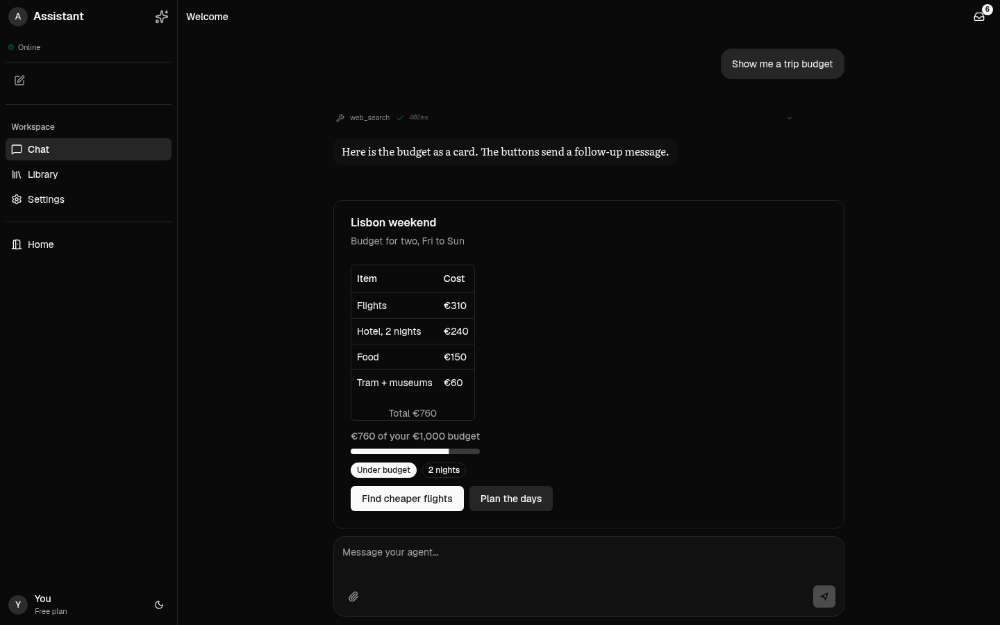
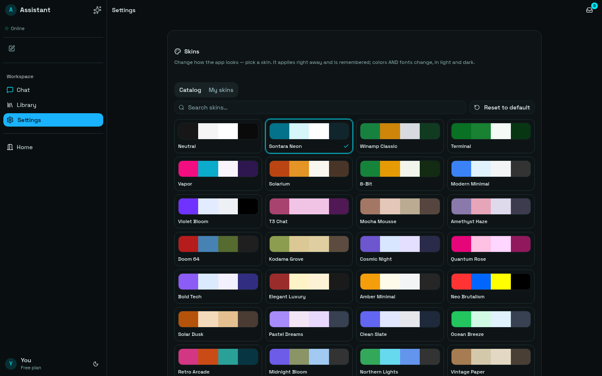
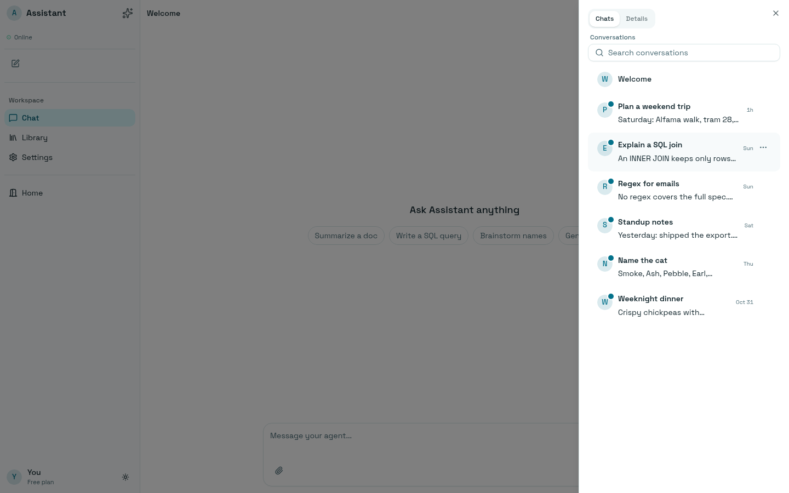

# chat-template-nuxt

A Nuxt 4 (Vue 3) chat app shell: left rail, chat, right panel on one shared top row,
plus Sontara's theme system. Auth, database and AI provider are all yours to pick.
A one-time 1:1 port of HFL's React/Next chat template, whose chat and theme code
comes from Sontara. This port is not kept in sync with either.



| Skins (~1000 themes) | Chat sessions panel, light mode |
|---|---|
|  |  |

```
app.vue                 theme cookie -> inlined CSS vars (no flash), dark mode, mounts the app
components/app/         EXAMPLE app: rail, chat sessions panel, conversations: replace these
components/chat/        vendored chat package (room, shell, sidebar, files, core)
components/gen-ui/      generative UI: json-render catalog, prompt, Vue registry, chat renderer
components/theme/       appearance picker, skin editor, ThemeVarsProvider
components/ui/          shadcn-vue primitives
lib/theme/              theme catalog (~1000 themes), CSS, cookie, local skin store
lib/mock-gateway.ts     fake backend so the template runs with no server
```

## Run

```
npm install
npm run dev      # http://localhost:3000
npm test         # vitest
npm run typecheck
```

## Connect a real backend

`<ChatRoom>` talks to any object with this shape (`components/chat/lib/use-gateway.ts`):

```ts
type GatewayHook = {
  rpc<T>(method: string, params?: unknown): Promise<T>; // chat.history, chat.send, chat.abort
  on(event: string, fn: (payload: unknown) => void): void; // "chat", "agent"
  off(event: string, fn: (payload: unknown) => void): void;
  connected: boolean; // or a ref / getter
};
```

- **A Sontara/OpenClaw-style agent:** `useGateway(url, token)`, the WebSocket RPC client.
- **Anything else (HTTP, SSE, an AI SDK route):** write an adapter with the same
  four members. `lib/mock-gateway.ts` is a complete working example of the wire:
  `chat` events carry cumulative `delta` text, then `final`, `error` or `aborted`.
  `agent` events carry `tool_call` and `tool_result`.

Swap the gateway in `components/app/chat-app.vue`.

## Layout

- **Left rail** (`components/app/rail.vue`): Sontara's agent sidebar. Identity
  row, status, a toolbar (New chat), the nav group with the motion pill on hover
  and active, an exit link, and the user footer. Ctrl/Cmd+B collapses it to
  icons; on mobile it is a sheet. Edit `NAV` in `chat-app.vue` to add views.
- **Chat sessions panel** (`components/app/sessions/`): Sontara's Messages
  panel. The inbox button with an unread badge opens a right sheet (same slide,
  drag-to-resize saved in the `sessions_panel_width` cookie). Rows carry the
  three-dot menu: mark as unread, mute, archive (archived rows shelve below).
  Search shows past 5 sessions. Mute and archive live in memory
  (`sessions/use-circle-prefs.ts`): persist them to your database there.

## Generative UI (json-render)

The assistant can answer with live components instead of only markdown.
`components/gen-ui/` wires [json-render](https://github.com/vercel-labs/json-render)
(`@json-render/vue`, pinned 0.21.4) into the chat. Try the "Generate a UI" chip.

The model writes normal text, then a fenced block of JSON patches:

````
Here is the budget as a card.

```spec
{"op":"add","path":"/root","value":"card"}
{"op":"add","path":"/elements/card","value":{"type":"Card","props":{"title":"Lisbon"},"children":[]}}
```
````

That is plain text, so it travels over any gateway with no wire changes. The
chat renders the fence as shadcn components (36 of them, themed by your theme),
built up while it streams.

Hook it up:

1. **Backend:** append `GEN_UI_PROMPT` (from `components/gen-ui/catalog.ts`,
   server-safe) to your system prompt. It teaches the model the catalog and
   the fence format.
2. **Chat:** `renderers: { ...RENDERERS, ...GEN_UI_RENDERERS }`, and pass a
   stable `{ send }` through `renderContext` so generated buttons can reply
   (`components/app/chat-app.vue` shows both).
3. **Outside chat:** `<GenUI :spec="spec" :handlers="{ ... }" />` renders any spec.

To narrow or extend what the model may build, edit the catalog: pick from
`shadcnComponentDefinitions` (`definitions.ts`, a copy of `@json-render/shadcn`'s
zod definitions: that package is React-only), add your own components, add
actions next to `send_message`, and register the matching component in
`registry.ts`. `prompt.fixture.txt` is the React template's prompt;
`spec-text.test.ts` asserts `GEN_UI_PROMPT` still equals it, so if you change the
catalog on purpose, regenerate the fixture.

## Theming

Settings in the rail opens the Appearance panel. A pick applies live, is saved
in the `theme` cookie, and is server-rendered on the next load. To also save it
to your database, pass `onSave` to `ThemeVarsProvider` in `app.vue`.
Custom skins live in localStorage (`lib/theme/skin-store.ts`); pass your own
`SkinStore` to persist them elsewhere.
